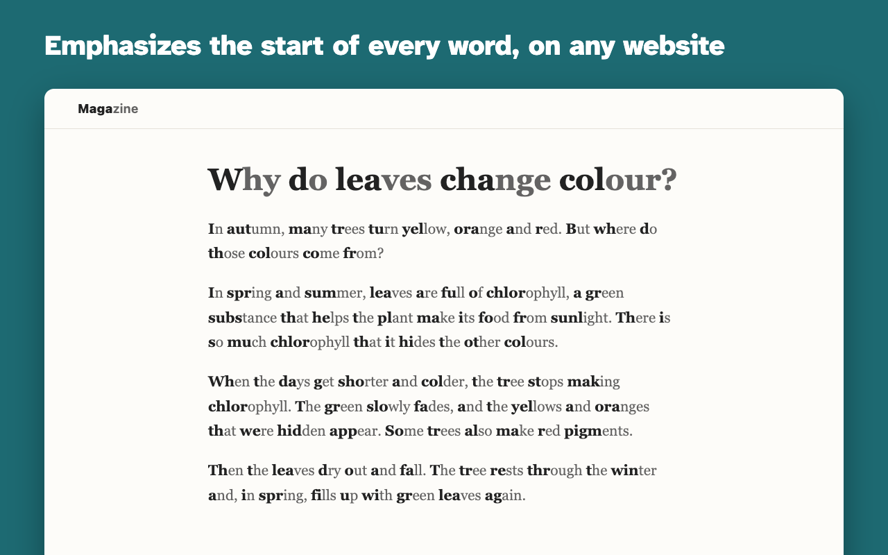
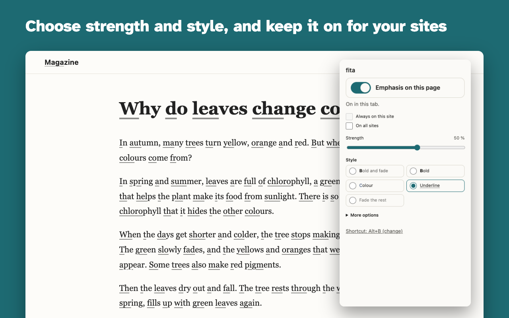
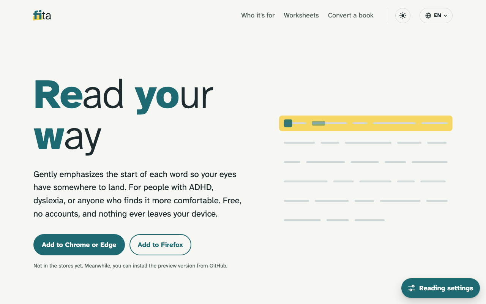
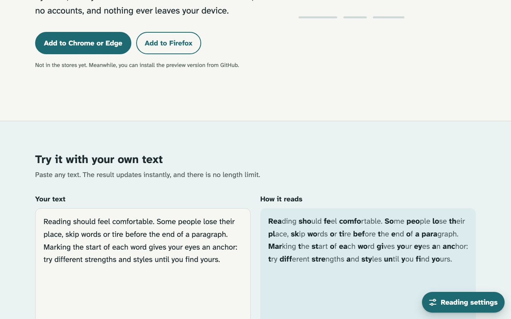
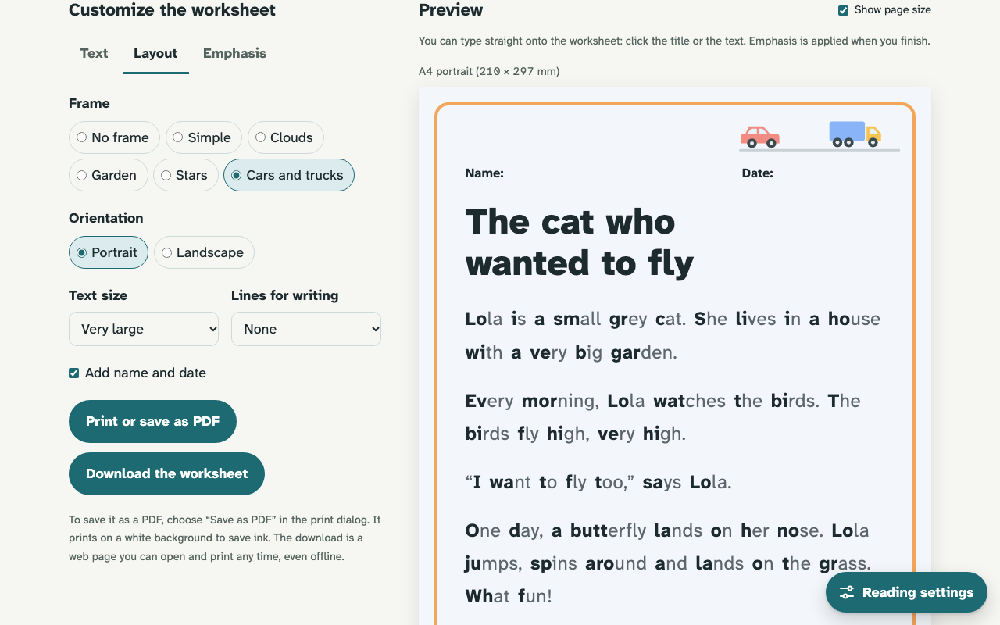
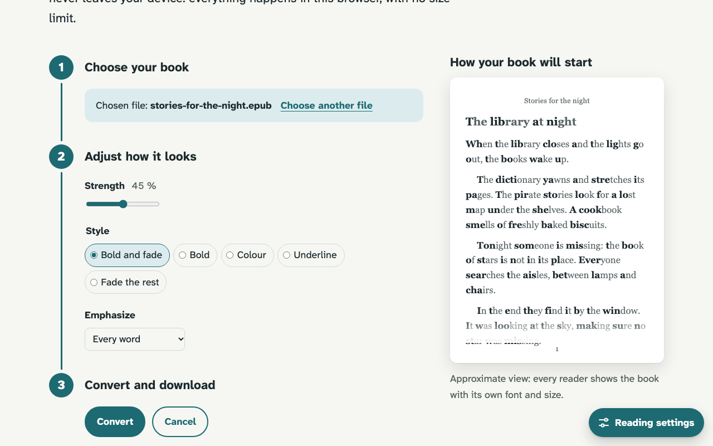
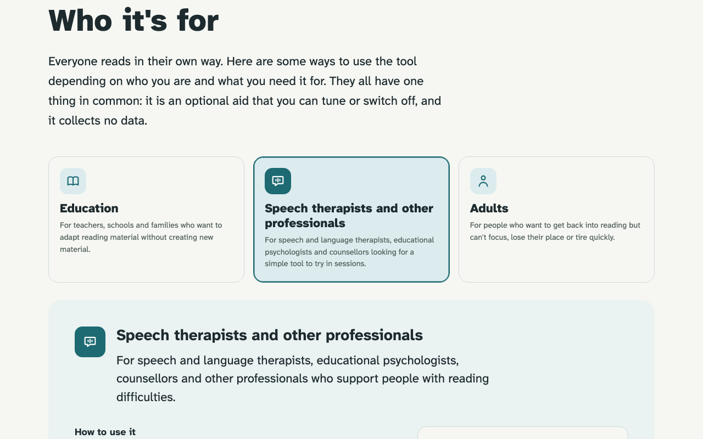

# fita

**Free, open-source reading aids for people with ADHD and dyslexia.** Website: [fitaread.com](https://fitaread.com)

fita adds _anchor points_ to text: it gently emphasizes the beginning of each word to guide your eyes. It works where you already read — on the web and in your ebooks — and everything runs on your device.

> We don't promise faster reading. Research does not show an average speed gain. We aim for reading that is **more comfortable, your way**.

## Screenshots

| | |
| --- | --- |
|  |  |
| **Browser extension**: emphasis on any website, on and off with Alt+B. | **Popup**: strength, five styles, always on for chosen sites. |
|  |  |
| **Website**: fitaread.com, in 27 languages. | **Live demo**: paste any text, no length limit. |
|  |  |
| **Reading worksheets** for children: frames, large print, print or download. | **Book converter**: EPUB, TXT, Markdown or HTML, with a first-page preview. |
|  | |
| **Who it's for**: ideas for classrooms, speech therapists and adults. | |

Regenerate the images with `node apps/extension/scripts/store-assets.mjs` (extension) and `node apps/web/scripts/readme-screenshots.mjs` (website).

## What's in this repository

| Path                               | What it is                                                                                       |
| ---------------------------------- | ------------------------------------------------------------------------------------------------ |
| [`packages/core`](packages/core)   | TypeScript library that decides which part of each word to emphasize, and applies it to the DOM. |
| [`apps/extension`](apps/extension) | Browser extension (Chrome, Edge, Firefox — including Firefox for Android).                       |
| [`apps/web`](apps/web)             | Static website ([fitaread.com](https://fitaread.com)) in 27 languages: live demo, reading worksheets and an in-browser ebook converter. |

## Languages

The website, the extension and the reading worksheets are available in 27 languages: Basque, Bulgarian, Catalan, Croatian, Czech, Danish, Dutch, English, Estonian, Finnish, French, Galician, German, Greek, Hungarian, Irish, Italian, Latvian, Lithuanian, Maltese, Polish, Portuguese, Romanian, Slovak, Slovenian, Spanish and Swedish. Emphasis itself works on text in any language with spaces between words.

Many translations were drafted with AI help and still need a native speaker's review (Irish and Maltese especially). Corrections are very welcome: open an issue or a pull request.

To add or fix a language, edit:

- `apps/web/src/locales/<lang>.ts`: website text and page URLs (the shape is defined by `es.ts`);
- `apps/web/src/worksheet/texts/<lang>/README.md`: children's reading texts for the worksheets;
- `apps/extension/src/locales/<lang>.json`: extension text (same keys as `en.json`);

then register the code in `apps/web/src/i18n.ts` and `apps/extension/src/build-data.ts`.

## Principles

- **Everything on the client.** No servers, accounts or APIs. Your files never leave your device.
- **No limits.** No word, size or usage caps, no paid features. Only your device's memory.
- **Total privacy.** No analytics, cookies or telemetry. See [PRIVACY.md](PRIVACY.md).
- **Several emphasis styles**: bold start with the rest faded (default), bold, colour, soft underline, or fading the rest of the word.
- **Accessible**: screen readers read the text exactly as before; keyboard-only use; dark mode.

## Development

Requires Node 22 and pnpm 10.

```sh
pnpm install
pnpm lint        # Biome
pnpm typecheck
pnpm test        # Vitest
pnpm build
pnpm e2e         # Playwright
```

Per package: `pnpm dev:web` (local website at http://localhost:4321), `pnpm preview:web`, `pnpm build:extension` (outputs `apps/extension/dist/`), and `test:*`, `build:*`, `e2e:*` for `core`, `extension` and `web`.

Brand images (social preview, favicon, extension icons) are rendered from the wordmark with `node apps/web/scripts/og-image.mjs`; the outputs are committed.

See [CONTRIBUTING.md](CONTRIBUTING.md).

## License

- **Code:** [Apache License 2.0](LICENSE). Use it, change it, build products with it, commercial ones included. If you redistribute it, keep the [NOTICE](NOTICE) file: it credits *fita — Oriol Martí Collell — https://fitaread.com*.
- **Texts, sample stories, documentation and images:** [CC BY 4.0](LICENSE-CONTENT.md). Same freedom, with credit.
- **Third-party components** keep their own licences: [THIRD_PARTY_NOTICES.md](THIRD_PARTY_NOTICES.md).

If fita helps you build something, we'd love to hear about it, and a visible mention of fitaread.com is always appreciated.

## In your language

The website and the extension speak every language below. A short introduction in each one:

<!-- languages:start -->
<details lang="ca"><summary><strong>Català</strong></summary>

Destaca suaument l'inici de cada paraula perquè la vista trobi on recolzar-se. Per a persones amb TDAH, dislèxia o qualsevol que ho trobi més còmode. Gratis, sense comptes i sense que res surti del teu dispositiu.

[fitaread.com/ca/](https://fitaread.com/ca/)

</details>
<details lang="cs"><summary><strong>Čeština</strong></summary>

Jemně zvýrazní začátek každého slova, aby se oči měly čeho chytit. Pro lidi s ADHD, dyslexií a pro každého, komu to tak vyhovuje. Zdarma, bez účtu a nic neopustí tvoje zařízení.

[fitaread.com/cs/](https://fitaread.com/cs/)

</details>
<details lang="da"><summary><strong>Dansk</strong></summary>

Fremhæver blidt starten af hvert ord, så øjnene har et sted at lande. Til mennesker med ADHD, ordblindhed eller alle, der synes, det er mere behageligt. Gratis, uden konto, og intet forlader nogensinde din enhed.

[fitaread.com/da/](https://fitaread.com/da/)

</details>
<details lang="de"><summary><strong>Deutsch</strong></summary>

Hebt den Anfang jedes Wortes sanft hervor, damit deine Augen einen Halt finden. Für Menschen mit ADHS, Legasthenie oder alle, denen es so angenehmer ist. Kostenlos, ohne Konto, und nichts verlässt jemals dein Gerät.

[fitaread.com/de/](https://fitaread.com/de/)

</details>
<details lang="et"><summary><strong>Eesti</strong></summary>

Tõstab õrnalt esile iga sõna alguse, et pilgul oleks kuhu toetuda. ATH või düsleksiaga inimestele ja kõigile, kellele see mugavam tundub. Tasuta, ilma kontota ja miski ei lahku kunagi sinu seadmest.

[fitaread.com/et/](https://fitaread.com/et/)

</details>
<details lang="en"><summary><strong>English</strong></summary>

Gently emphasizes the start of each word so your eyes have somewhere to land. For people with ADHD, dyslexia, or anyone who finds it more comfortable. Free, no accounts, and nothing ever leaves your device.

[fitaread.com/en/](https://fitaread.com/en/)

</details>
<details lang="es"><summary><strong>Español</strong></summary>

Destaca suavemente el inicio de cada palabra para que la vista encuentre dónde apoyarse. Para personas con TDAH, dislexia o cualquiera que lo encuentre más cómodo. Gratis, sin cuentas y sin que nada salga de tu dispositivo.

[fitaread.com/es/](https://fitaread.com/es/)

</details>
<details lang="eu"><summary><strong>Euskara</strong></summary>

Hitz bakoitzaren hasiera leunki nabarmentzen du, begiek non bermatu izan dezaten. TDAH edo dislexia duten pertsonentzat, edo horrela erosoago irakurtzen duen edonorentzat. Doakoa, konturik gabe, eta ezer ez da zure gailutik ateratzen.

[fitaread.com/eu/](https://fitaread.com/eu/)

</details>
<details lang="fr"><summary><strong>Français</strong></summary>

Met doucement en évidence le début de chaque mot pour donner un point d’appui à vos yeux. Pour les personnes avec un TDAH, une dyslexie, ou pour toute personne qui s’y sent plus à l’aise. Gratuit, sans compte, et rien ne quitte jamais votre appareil.

[fitaread.com/fr/](https://fitaread.com/fr/)

</details>
<details lang="ga"><summary><strong>Gaeilge</strong></summary>

Cuireann sé béim bhog ar thús gach focail, ionas go mbíonn áit ag do shúile le stopadh. Do dhaoine a bhfuil ADHD nó disléicse orthu, nó d’aon duine a bhfuil sé níos compordaí dóibh. Saor in aisce, gan chuntas, agus ní fhágann aon rud do ghléas riamh.

[fitaread.com/ga/](https://fitaread.com/ga/)

</details>
<details lang="gl"><summary><strong>Galego</strong></summary>

Destaca suavemente o inicio de cada palabra para que a vista teña onde apoiarse. Para persoas con TDAH, con dislexia ou para calquera que o atope máis cómodo. Gratis, sen contas e sen que nada saia do teu dispositivo.

[fitaread.com/gl/](https://fitaread.com/gl/)

</details>
<details lang="hr"><summary><strong>Hrvatski</strong></summary>

Nježno ističe početak svake riječi kako bi pogled imao gdje stati. Za osobe s ADHD-om, disleksijom i za svakoga kome je tako ugodnije. Besplatno, bez računa i ništa nikad ne napušta tvoj uređaj.

[fitaread.com/hr/](https://fitaread.com/hr/)

</details>
<details lang="it"><summary><strong>Italiano</strong></summary>

Mette delicatamente in evidenza l’inizio di ogni parola, così gli occhi hanno un punto su cui posarsi. Per chi ha l’ADHD, la dislessia o semplicemente si trova più a proprio agio. Gratis, senza account, e niente lascia mai il tuo dispositivo.

[fitaread.com/it/](https://fitaread.com/it/)

</details>
<details lang="lv"><summary><strong>Latviešu</strong></summary>

Maigi izceļ katra vārda sākumu, lai acīm būtu kur atbalstīties. Cilvēkiem ar UDHS, disleksiju vai ikvienam, kam tā ir ērtāk. Bez maksas, bez kontiem, un nekas neatstāj tavu ierīci.

[fitaread.com/lv/](https://fitaread.com/lv/)

</details>
<details lang="lt"><summary><strong>Lietuvių</strong></summary>

Švelniai paryškina kiekvieno žodžio pradžią, kad akys turėtų kur atsiremti. Žmonėms, turintiems ADHD, disleksiją, ar visiems, kam taip patogiau. Nemokamai, be paskyrų, ir niekas neišeina iš tavo įrenginio.

[fitaread.com/lt/](https://fitaread.com/lt/)

</details>
<details lang="hu"><summary><strong>Magyar</strong></summary>

Finoman kiemeli minden szó elejét, hogy a szemednek legyen hol megpihennie. ADHD-val vagy diszlexiával élőknek, és bárkinek, akinek így kényelmesebb. Ingyenes, nem kell hozzá fiók, és semmi sem hagyja el az eszközödet.

[fitaread.com/hu/](https://fitaread.com/hu/)

</details>
<details lang="mt"><summary><strong>Malti</strong></summary>

Tenfasizza bil-mod il-bidu ta’ kull kelma biex għajnejk ikollhom fejn jistrieħu. Għal persuni b’ADHD, b’dislessija, jew għal kull min isibha aktar komda. B’xejn, mingħajr kontijiet, u xejn ma joħroġ mill-apparat tiegħek.

[fitaread.com/mt/](https://fitaread.com/mt/)

</details>
<details lang="nl"><summary><strong>Nederlands</strong></summary>

Laat het begin van elk woord rustig opvallen, zodat je ogen een houvast hebben. Voor mensen met ADHD, dyslexie of iedereen die het zo prettiger vindt. Gratis, zonder account, en er gaat nooit iets van je apparaat af.

[fitaread.com/nl/](https://fitaread.com/nl/)

</details>
<details lang="pl"><summary><strong>Polski</strong></summary>

Delikatnie wyróżnia początek każdego słowa, żeby wzrok miał się o co zaczepić. Dla osób z ADHD, dysleksją i dla każdego, komu tak jest wygodniej. Za darmo, bez zakładania konta, a nic nie opuszcza twojego urządzenia.

[fitaread.com/pl/](https://fitaread.com/pl/)

</details>
<details lang="pt"><summary><strong>Português</strong></summary>

Destaca suavemente o início de cada palavra para que os olhos tenham onde pousar. Para pessoas com PHDA, dislexia ou para quem simplesmente se sente mais à vontade assim. Gratuito, sem contas, e nada sai do seu dispositivo.

[fitaread.com/pt/](https://fitaread.com/pt/)

</details>
<details lang="ro"><summary><strong>Română</strong></summary>

Evidențiază discret începutul fiecărui cuvânt, ca ochii să aibă unde să se oprească. Pentru persoanele cu ADHD, dislexie sau pentru oricine se simte mai confortabil așa. Gratuit, fără conturi, și nimic nu iese vreodată de pe dispozitivul tău.

[fitaread.com/ro/](https://fitaread.com/ro/)

</details>
<details lang="sk"><summary><strong>Slovenčina</strong></summary>

Jemne zvýrazní začiatok každého slova, aby sa oči mali čoho chytiť. Pre ľudí s ADHD, dyslexiou a pre každého, komu to tak vyhovuje. Zadarmo, bez účtu a nič neopustí tvoje zariadenie.

[fitaread.com/sk/](https://fitaread.com/sk/)

</details>
<details lang="sl"><summary><strong>Slovenščina</strong></summary>

Nežno poudari začetek vsake besede, da se pogled lahko nekam ujame. Za ljudi z ADHD, disleksijo in za vse, ki jim je tako udobneje. Brezplačno, brez računa in nič ne zapusti tvoje naprave.

[fitaread.com/sl/](https://fitaread.com/sl/)

</details>
<details lang="fi"><summary><strong>Suomi</strong></summary>

Korostaa hienovaraisesti jokaisen sanan alkua, jotta katseella on mihin tarttua. Ihmisille, joilla on ADHD tai lukihäiriö, ja kaikille, joista se tuntuu mukavammalta. Maksuton, ei käyttäjätilejä, eikä mikään koskaan lähde laitteeltasi.

[fitaread.com/fi/](https://fitaread.com/fi/)

</details>
<details lang="sv"><summary><strong>Svenska</strong></summary>

Framhäver varsamt början av varje ord så att blicken har någonstans att landa. För personer med adhd, dyslexi eller alla som tycker att det är skönare så. Gratis, utan konto, och ingenting lämnar någonsin din enhet.

[fitaread.com/sv/](https://fitaread.com/sv/)

</details>
<details lang="el"><summary><strong>Ελληνικά</strong></summary>

Τονίζει απαλά την αρχή κάθε λέξης, ώστε το βλέμμα να έχει πού να σταθεί. Για άτομα με ΔΕΠΥ, δυσλεξία ή για όποιον το βρίσκει πιο άνετο. Δωρεάν, χωρίς λογαριασμούς, και τίποτα δεν φεύγει από τη συσκευή σου.

[fitaread.com/el/](https://fitaread.com/el/)

</details>
<details lang="bg"><summary><strong>Български</strong></summary>

Нежно подчертава началото на всяка дума, за да има къде да се спре погледът. За хора със СДВХ, дислексия или за всеки, на когото така му е по-удобно. Безплатно, без акаунти и нищо не напуска устройството ти.

[fitaread.com/bg/](https://fitaread.com/bg/)

</details>
<!-- languages:end -->
